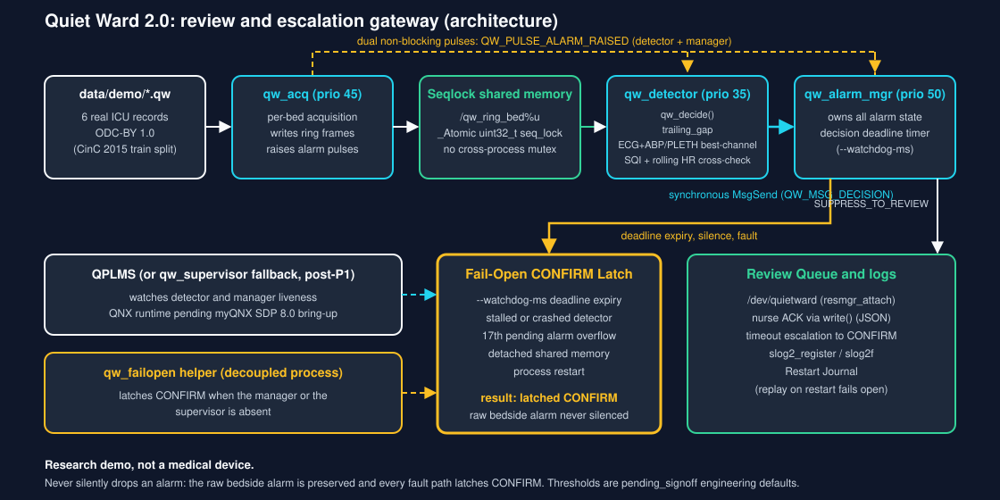

# Quiet Ward 2.0

> **Research demo, not a medical device.** Not validated for clinical use, not for patient care.
> The suppression thresholds in `rules/alarm_rules.json` carry `status: "pending_signoff"`: they are engineering defaults, not signed clinical rules.

Quiet Ward is a **secondary review and escalation gateway** for bedside monitor alarms, built for the QNX Global Hackathon (Robotics & Medical). It looks at the signals behind an arrhythmia alarm and, when a second channel clearly contradicts it, queues that alarm for a nurse to review instead of treating it as urgent. It never removes the bedside alarm.

**Status of the QNX runtime.** The target runtime is QNX 8.0 (IPC processes under `src/qnx/`, QEMU boot). Today the verified part is host-portable C11: the seqlock ring (`qw_ring`), the gateway state machine (`qw_gateway_state`), logging and the resource-manager helpers, tested by `qw_gateway_test` (`make gateway-test`: 529 checks, 0 failed). The six process sources under `src/qnx/` (acquisition, detector, alarm manager, fail-open helper, supervisor, bed control) are written behind `#ifdef __QNX__` but have **not** been compiled with `qcc` or run on QEMU: that is pending P1, the myQNX SDP 8.0 licence bring-up. Nothing in this repository claims a result measured on QNX.

## Architecture and safety invariant

The invariant: **an alarm is never silently dropped.**

- The raw bedside alarm is preserved. Quiet Ward only adds a second opinion.
- A candidate suppression is not discarded: it is queued on `/dev/quietward` for a nurse ACK, with timeout escalation.
- Every fault path fails open to `CONFIRM`: detector crash, decision timeout, a 17th pending alarm, detached shared memory, and process restart (journal replay).



Diagram source: [`docs/workflow.svg`](docs/workflow.svg). Process layout and QNX primitive mapping: [`src/qnx/README.md`](src/qnx/README.md). Stress and fail-open verification status (host passes, QEMU pending): [`submission/g3/stress-checklist.md`](submission/g3/stress-checklist.md).

## Where QNX 8.0 Appears (Reviewer Map)

Every primitive below is present in the committed source (paths as listed). None of it has been compiled with `qcc` or booted yet, so each target output is marked `[PENDING P1: ...]` (P1 = myQNX SDP 8.0 licence bring-up). Video scenes refer to `video/SCRIPT_V2_DRAFT.md`.

| File | QNX 8.0 / POSIX / C11 primitives & tooling present in source | Expected target output | Video scene |
|---|---|---|---|
| `src/qnx/qw_acq.c` | `shm_open`, `mmap`, `ChannelCreate`, `ConnectAttach`, `ConnectDetach`, `SIGEV_PULSE_INIT`, `timer_create`, `timer_settime`, `MsgReceivePulse`, `name_open`, `MsgSendPulse`, `name_close` | [PENDING P1: replay .qw ring + QW_PULSE_ALARM_RAISED pulse, visible in pidin] | S02, S05 |
| `src/qnx/qw_detector.c` | `name_attach`, `name_open`, `name_close`, `shm_open`, `mmap`, `MsgReceive`, `MsgReply`, `MsgError`, `TimerTimeout`, `MsgSend`, `ConnectDetach` | [PENDING P1: reads seqlock ring, sends QW_MSG_DECISION via MsgSend, restarted/killed in soak] | S02, S05 |
| `src/qnx/qw_alarm_mgr.c` | `name_attach`, `ConnectAttach`, `ConnectDetach`, `SIGEV_PULSE_INIT`, `timer_create`, `timer_settime`, `MsgReceive`, `MsgReply`, `MsgError` (`sigval.sival_ptr`->`rcvid_t` cast to confirm under `qcc` at P1), `pthread_create`, `pthread_detach` | [PENDING P1: 50 ms watchdog tick, deadline latch CONFIRM, journal + /dev/quietward thread, visible in pidin] | S02, S05 |
| `src/qnx/qw_failopen.c` | standalone fail-open binary (invoked by `qw_supervisor` after >3 restarts or manually; needs no running supervisor/IPC to write `CONFIRM_ALL`): `open` with `O_NOFOLLOW`, `write` of `CONFIRM_ALL`, `qw_log_emit` at CRIT | [PENDING P1: writes CONFIRM_ALL to /var/run/quietward/alarm_out + CRIT in slog2info -b quietward] | S02, S05 |
| `src/qnx/qw_supervisor.c` | `posix_spawn`, `waitpid`, `kill`, `sigaction` | [PENDING P1: spawns/restarts qw_alarm_mgr and qw_detector, invokes qw_failopen after >3 restarts, visible in pidin] | S02, S05 |
| `src/qnx/qw_bedctl.c` | `open("/dev/quietward")`, `devctl(QW_DCMD_BED_STATE)` | [PENDING P1: prints per-bed JSON including failopen_active via devctl] | S05 |
| `src/qnx/qw_resmgr.c` | `dispatch_create`, `iofunc_func_init`, `iofunc_attr_init`, `resmgr_attach("/dev/quietward")`, `dispatch_context_alloc`, `dispatch_block`, `dispatch_handler`, `iofunc_read_verify`, `iofunc_write_verify`, `iofunc_devctl_default`, `resmgr_msgget`, `_IO_READ_GET_NBYTES`, `_IO_WRITE_GET_NBYTES`, `_IO_SET_READ_NBYTES`, `_IO_SET_WRITE_NBYTES`, `MsgReply` | [PENDING P1: cat /dev/quietward JSONL stream, write() nurse ACK] | S02, S05 |
| `src/qnx/qw_log.c` | `slog2_register`, `slog2f` (`SLOG2_INFO`, `SLOG2_WARNING`, `SLOG2_ERROR`, `SLOG2_CRITICAL`) | [PENDING P1: slog2info -b quietward audit lines] | S05 |
| `src/qnx/qw_ring.h`, `src/qnx/qw_ring.c` | C11 `_Atomic` seqlock ring over `/qw_ring_bed%u` shared memory (`qw_ring_init`, `qw_ring_write`, `qw_ring_read_tail`; host-tested in `qw_gateway_test`, mapped with `shm_open`/`mmap` on QNX) | [PENDING P1: lock-free sample ring between qw_acq and qw_detector over /dev/shmem/qw_ring_bed*] | S02, S05 |
| `src/qnx/qw_ipc.h` | `QW_DCMD_BED_STATE`, `QW_PULSE_*`, `QW_MSG_DECISION`, `qw_ring_hdr_t` (`_Atomic` ring header) | [PENDING P1: shared IPC contract across all QNX processes] | S02, S05 |
| `src/qnx/qw_gateway_state.h`, `src/qnx/qw_gateway_state.c`, `src/qnx/qw_gateway_test.c` | portable C11 gateway state machine, `O_NOFOLLOW` journal, `529 checks, 0 failed` on host | `qw_gateway_test: 529 checks, 0 failed` (host); [PENDING P1: linked into qw_alarm_mgr, qw_acq, qw_failopen] | S02, S05 |
| `src/qnx/qw_resmgr.h`, `src/qnx/qw_log.h` | C11 interfaces for `/dev/quietward` JSONL serializer and `slog2` audit formatter | host-verified in `qw_gateway_test`; [PENDING P1: /dev/quietward + slog2f on target] | S02, S05 |
| `scripts/p1_hello_ipc.c` | `ChannelCreate`, `ConnectAttach`, `MsgSend`, `MsgReceive`, `MsgReply`, `TimerTimeout`, `slog2_register`, `slog2f`, `clock_gettime` | [PENDING P1: P1_HELLO_RESULT=PASS + slog2info -b qw_hello] | S05 |
| `scripts/p1_qplms_probe.sh` | `plms` / `plmsctrl` / `slog2info -b plms` availability probe | [PENDING P1: PROBE_RESULT=QPLMS_PRESENT or USE_QW_SUPERVISOR_FALLBACK] | S02, S07 |
| `scripts/p1_tcg_jitter.c` | `clock_gettime(CLOCK_MONOTONIC)`, `clock_gettime(CLOCK_REALTIME)`, `nanosleep` QEMU TCG jitter calibrator | [PENDING P1: recommended --watchdog-ms] | S05, S07 |
| `Makefile` | QNX targets `qnx-check`, `qnx`, `qnx-build`, `qnx-clean`: `qcc -Vgcc_ntox86_64 -std=c11 -D_QNX_SOURCE -O2 -Wall -Wextra -Werror`, `-lm -lslog2` | [PENDING P1: build/qnx/{qw_acq,qw_detector,qw_alarm_mgr,qw_failopen,qw_supervisor,qw_bedctl}] | S07 |
| `scripts/p3_qnx_soak.sh` | 10-run QNX target soak using `pidin`, `slay`, `/dev/quietward`, `qw_bedctl`, `slog2info` | [PENDING P1: submission/g3/g3_run_01..10.txt] | S05 |
| `.devcontainer/devcontainer.json` | Ubuntu 24.04 Linux image + `qemu-system-x86` + `build-essential` bring-up container for QNX SDP 8.0 (the SDK itself is installed separately after the licence) | [PENDING P1: devcontainer config written, not yet built or run] | S07 |

The host-portable parts (`qw_ring`, `qw_gateway_state`, `qw_log` formatter, `qw_resmgr` JSONL serializer) are the only pieces that run today, under `make gateway-test`.

## QNX 8.0 Target, Toolchain & Build/Run Instructions

- **QNX version:** QNX SDP 8.0 / QNX Neutrino RTOS 8.0.
- **Host requirement:** GitHub Codespaces (x86_64) or an x86_64 Linux host (commands use `bash`/`sh` and `~/qnx800/qnxsdp-env.sh`); a local arm64 container on Apple Silicon is not expected to run SDP 8.0 x86_64 host tools natively (expected, verify at P1).
- **Target:** QNX 8.0 x86_64 QEMU image (built from SDP 8.0), plus host-portable C11 for the offline checks.
- **Toolchain:** `qcc -Vgcc_ntox86_64 -std=c11 -D_QNX_SOURCE -O2 -Wall -Wextra -Werror`, linked with `-lm -lslog2`; GNU Make; `source ~/qnx800/qnxsdp-env.sh` on an x86_64 Linux host; `.devcontainer/devcontainer.json` (Ubuntu 24.04, QEMU, build-essential) for an x86_64 Codespace or container.

**Cross-build (x86_64 Linux, SDP 8.0 installed) [PENDING P1: not yet run]:**

```sh
source ~/qnx800/qnxsdp-env.sh   # path depends on your SDP install
make qnx-check                  # confirms qcc is on PATH
make qnx                        # -> build/qnx/{qw_acq,qw_detector,qw_alarm_mgr,qw_failopen,qw_supervisor,qw_bedctl}
```

**Build & boot the QNX 8.0 x86_64 QEMU image and copy assets via `scp` [PENDING P1: not yet run]:**

1. Build and boot the QNX 8.0 x86_64 QEMU target image from SDP 8.0 (e.g., `mkqnximage` / `qemu-system-x86_64` under `.devcontainer/devcontainer.json`; exact SDP 8.0 image-builder flags to be verified at P1 bring-up).
2. Create `/opt/quietward/{bin,rules,config,data/demo,scripts}` on the booted target and copy the cross-built assets in via `scp`: `build/qnx/*` -> `/opt/quietward/bin/` (the six binaries), `rules/alarm_rules.json` -> `/opt/quietward/rules/alarm_rules.json`, `config/detector.json` -> `/opt/quietward/config/detector.json`, `data/demo/*.qw` -> `/opt/quietward/data/demo/` (all six `.qw` records; `scripts/p3_qnx_soak.sh` replays 3 of them: `a109l`, `a653l`, `v188s`), and `scripts/p3_qnx_soak.sh` -> `/opt/quietward/scripts/p3_qnx_soak.sh`.

**Run on the target [PENDING P1: no output captured yet]:**

```sh
mkdir -p /var/run/quietward && chmod 0700 /var/run/quietward
/opt/quietward/bin/qw_supervisor /opt/quietward/rules/alarm_rules.json /opt/quietward/config/detector.json --bin-dir /opt/quietward/bin &
/opt/quietward/bin/qw_acq /opt/quietward/data/demo/a109l.qw Asystole --bed 0 --seq 101 --rate-ms 100
cat /dev/quietward | head -n 1            # JSONL decision stream (non-blocking)
/opt/quietward/bin/qw_bedctl 0           # per-bed JSON via devctl
slog2info -b quietward                   # audit lines
sh /opt/quietward/scripts/p3_qnx_soak.sh -o /opt/quietward/out  # 10-run soak -> /opt/quietward/out/g3_run_01..10.txt + slog2_run_01..10.txt
```

After the soak completes, copy `/opt/quietward/out/g3_run_01..10.txt` and `/opt/quietward/out/slog2_run_01..10.txt` back to `submission/g3/` in the repo via `scp` or a QEMU shared directory.

**Host commands (clean `git archive HEAD` export without `.git`/`.venv`/`.pytest_cache`; suite contains no network-using commands, no pip, no SDK):**

```sh
make
make gateway-test
make reentrant-test
make demo-verify
make fuzz            # runs scripts/fuzz_qw.py --count 1000 via .venv/bin/python when present, else python3
python3 scripts/host_shift_replay.py
python3 scripts/render_demo_plots.py
```

Additional host suites (beyond stdlib/C11): `make test` additionally requires `pytest` and `numpy`; `scripts/fetch_physionet.sh` and the full 750-record `make eval` additionally require `wfdb` and `numpy`.

## Evaluated results (no clinical claims)

Source: real PhysioNet/CinC 2015 training records, local split in `eval/split.json`, rules `pending_signoff`. Scores are the Challenge score in percent. "Base" is no suppression at all (every alarm confirmed). FN counts true alarms that were queued for review instead of confirmed.

**Train split** (`eval/results/train_fixed.json`, N=523)

| Version | Score | FN |
|---|---|---|
| Base (no suppression) | 39.2% | 0 |
| v0 (frozen) | 40.2% | 49 |
| fixed | 53.8% | 3 |

Fixed true-alarm recall: 98.5% (202 of 205), 95% CI [95.8-99.5]. Kill Rule: **PASS**.

**Held-out split** (`eval/results/heldout_fixed.json`, N=227; runs 1 and 2 of 3 used, run 3 reserved and untouched)

| Version | Score | FN |
|---|---|---|
| Base (no suppression) | 39.2% | 0 |
| v0 (frozen) | 40.8% | 18 |
| fixed | 51.5% | 3 |

Fixed true-alarm recall: 96.6% (86 of 89), 95% CI [90.6-98.8]. Ventricular tachycardia FN went 11 to 0.

**Kill Rule: FAIL, so we ship Variant B.** On held-out, Asystole FN moved from 0 to 1, on only 37 Asystole records (low n). We did **not** retune on the held-out set. The honest read: the fixed rules beat v0 and the baseline on held-out, but they break our own rule that no alarm type may miss more true alarms than v0 did. So the entry is framed as a review gateway (Variant B), not as a validated suppressor.

**Not comparable to the Challenge leaderboard.** The PhysioNet/CinC 2015 winners scored 81.39 (Event 1) and 85.04 (Event 2) on a different 500-record hidden test set. Our numbers come from a different, local split, so they are not directly comparable.

### The six `data/demo/` records

Regenerate with `python3 scripts/host_shift_replay.py` (writes `submission/g3/host_shift_review.{json,md}`). Six records is a demonstration, not an accuracy measurement.


Overview: [`docs/plots/demo_overview.svg`](docs/plots/demo_overview.svg) (one SVG per record sits beside it). Each plot shows the 16 s before the alarm at 300 s, an ECG lead and the pulse channel with their quality indices, and the exact `build/qw` reason. They are generated offline with `python3 scripts/render_demo_plots.py` (stdlib Python only) from the real ODC-BY 1.0 `train`-split records: zero synthetic data.

| Record | Alarm | Truth | Decision | Why |
|---|---|---|---|---|
| a109l | Asystole | false | SUPPRESS_TO_REVIEW | pulse present in the trailing 5 s, so the asystole alarm is contradicted; queued for nurse review |
| a653l | Asystole | true | CONFIRM | pulse not continuous in the trailing 5 s (trailing gap 3.41 s over the 3.20 s limit) |
| t116s | Tachycardia | false | CONFIRM | conservative miss: the ECG cross-check still reports a max heart rate of 160 bpm, above the 140 bpm threshold, so the alarm stays confirmed |
| t106s | Tachycardia | true | CONFIRM | pulsatile channel quality 0.85, below the 0.90 minimum, so no suppression is attempted |
| v188s | Ventricular_Tachycardia | true | CONFIRM | ECG max heart rate 242 bpm exceeds the threshold; pulse does not contradict |
| f450s | Ventricular_Flutter_Fib | true | CONFIRM | on the never-suppress list; confirmed unconditionally |

`t116s` is the instructive one: a false alarm that is still confirmed. That is the intended failure direction (a missed suppression adds noise, a missed alarm would add risk).

## Build, tests and fresh-clone reproduce

Offline, no network and no pip needed for the C builds and the stdlib checks:

```sh
make                 # build/qw
make gateway-test    # seqlock ring + gateway state machine (host-portable C11)
make reentrant-test  # concurrent qw_decide() calls, no shared state
make demo-verify     # checks data/demo/ against MANIFEST.json hashes
make fuzz            # runs scripts/fuzz_qw.py --count 1000 via .venv/bin/python when present, else python3 (1000 seeded mutations, stdlib Python)
python3 scripts/host_shift_replay.py   # six-record replay report
python3 scripts/render_demo_plots.py   # docs/plots/*.svg from the six real records
```

`make gateway-test` currently reports `qw_gateway_test: 529 checks, 0 failed`.

**`make qnx` (not run yet).** On an x86_64 Linux host with the QNX SDP 8.0 environment sourced, `make qnx` cross-builds the `#ifdef __QNX__` processes under `src/qnx/` with `qcc`; `make qnx-check` only verifies that `qcc` is on the path. These targets are uncompiled and untested on the host until SDP 8.0 P1 bring-up, so no QNX build or QEMU result is claimed.

`make test` additionally runs the pytest suite (needs `pytest` and `numpy`).

**Full 750-record evaluation.** The raw records are not stored in the repository. `scripts/fetch_physionet.sh` downloads the PhysioNet/CinC 2015 training set and converts it to `data/bin/` (needs `wfdb` and `numpy` in `.venv`). Then `make eval-train` reproduces the train table above. The held-out split has a limited run budget (`eval/heldout_runs.log`); do not spend run 3.

## Data and attribution

All signals are real, de-identified ICU records from the PhysioNet/Computing in Cardiology Challenge 2015, redistributed under the **Open Data Commons Attribution License (ODC-BY) 1.0**.

> Dataset: PhysioNet/Computing in Cardiology Challenge 2015, DOI [10.13026/c9fg-a467](https://doi.org/10.13026/c9fg-a467) (ODC-BY 1.0). Paper: Clifford GD, Silva I, Moody B, Li Q, Kella D, Shahin A, Kooistra T, Perry D, Mark RG (2015). The PhysioNet/Computing in Cardiology Challenge 2015: Reducing False Arrhythmia Alarms in the ICU. Computing in Cardiology 42:273-276.

Only the six `data/demo/` records are redistributed, converted from WFDB to the `.qw` format. See [`LICENSE`](LICENSE), [`NOTICE`](NOTICE), [`DATA_CARD.md`](DATA_CARD.md), `data/demo/LICENSE-ODC-BY.txt` and [`JUDGES.md`](JUDGES.md).

## Repository provenance and licence

`DrAhmed7887/hack-qnx` is a new, non-fork repository (pending owner click); first commit `d1d0bd6` on 22 Nov 2026 (`submission/g3/git_birth_commit.txt`; GitHub creation date / submission-period check pending owner click). Code is under the **Apache License 2.0** (`LICENSE` present; GitHub About detection pending owner click); the data keeps its **ODC-BY 1.0** attribution (PhysioNet/CinC Challenge 2015 dataset, DOI 10.13026/c9fg-a467). Compliance status for every Devpost email item: [`submission/COMPLIANCE_CHECKLIST.md`](submission/COMPLIANCE_CHECKLIST.md). Every measured benchmark, test result, and external clinical/leaderboard figure in the public text maps to a committed file in [`CLAIMS.md`](CLAIMS.md).
