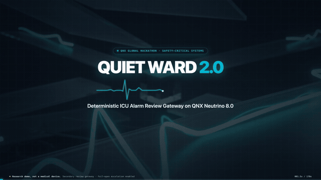
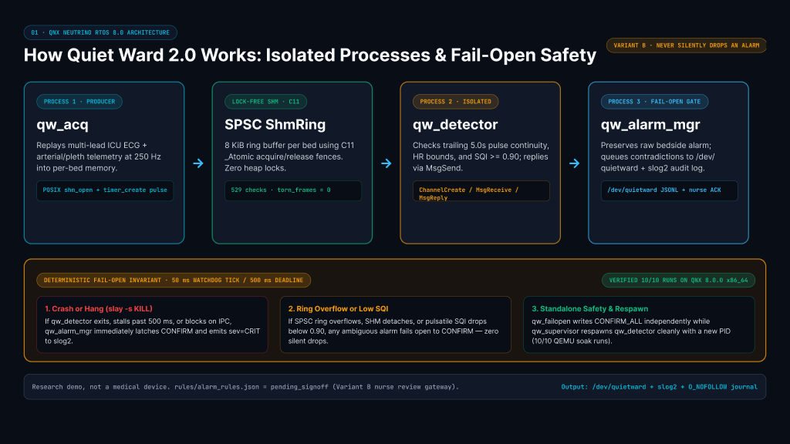
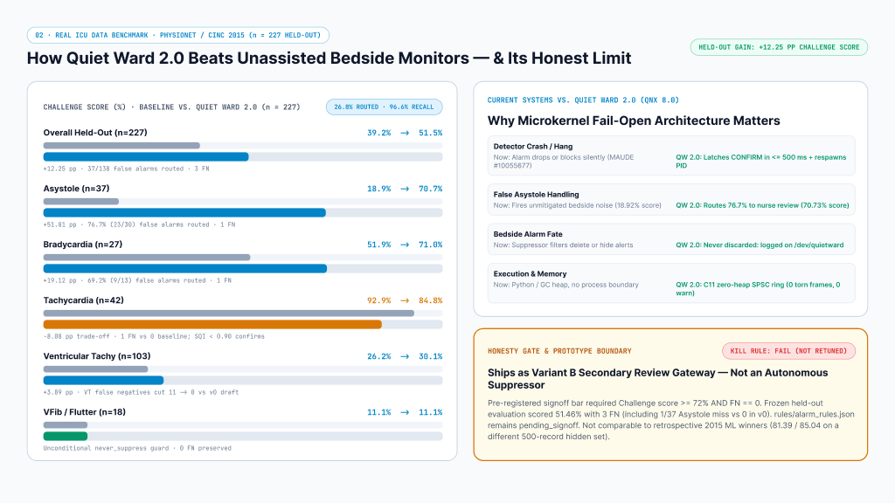
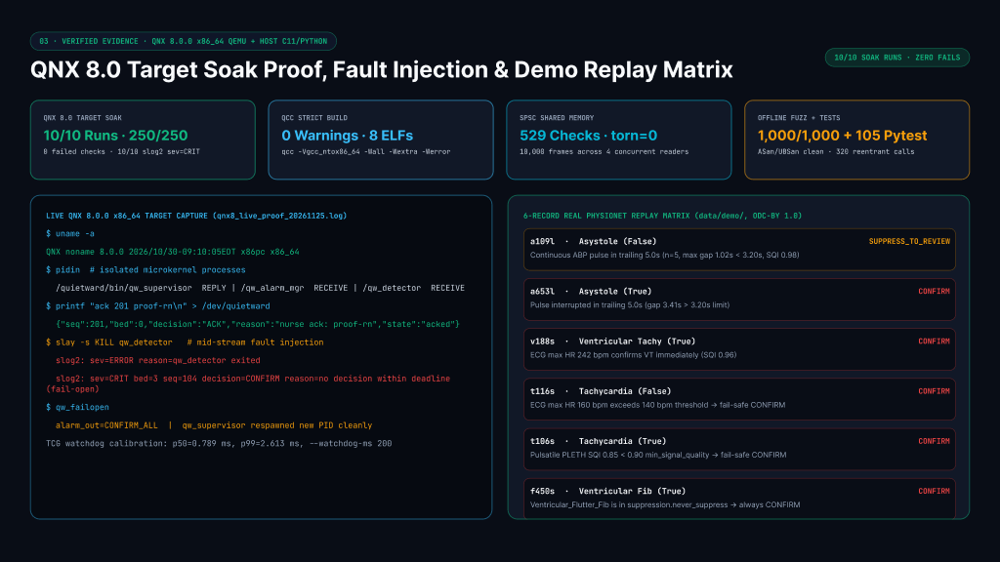

# Quiet Ward 2.0

<p align="center">
  
</p>

<p align="center">
  <strong>Shadow-Mode Secondary Review Gateway Prototype on QNX Neutrino RTOS 8.0</strong><br />
  <a href="docs/index.html">Interactive Companion (docs/index.html)</a> ·
  <a href="https://youtu.be/1vQkHxxzaIQ">Demo Video (YouTube)</a> ·
  <a href="https://www.figma.com/design/6yKhzpDwLqsvxt3T9dfb3K">Figma Architecture &amp; Benchmark Deck</a> ·
  <a href="JUDGES.md">Judging Map</a> ·
  <a href="CLAIMS.md">Verified Claims</a>
</p>

ICU clinicians face severe **alarm fatigue**: bedside monitors fire overwhelmingly false arrhythmia alerts, burying genuine deterioration in noise. Quiet Ward 2.0 is a deterministic C11 **shadow-mode secondary review research prototype** on **QNX Neutrino RTOS 8.0** modeled for central-station / corridor-pager triage: **no alarm is intentionally discarded in routing logic.** The bedside alarm remains untouched, contradicted candidate false alarms are queued onto `/dev/quietward` (`state: "review"`), and within the tested fault envelope (detector kill/deadline expiry, low signal quality, detached/busy shared memory, global pending queue overflow, resmgr/journal degradation, and Tier-2 `qw_failopen`) failures latch `CONFIRM` instead of silently suppressing.

<!-- prettier-ignore -->
> [!IMPORTANT]
> **Research demo, not a medical device.** Not validated for clinical use or patient care. The heuristic thresholds in [`rules/alarm_rules.json`](rules/alarm_rules.json) carry `status: "pending_signoff"` (engineering defaults, not signed clinical rules).

---

## How Quiet Ward 2.0 Works

Quiet Ward splits telemetry ingest, signal analysis, and alarm latching into isolated QNX Neutrino 8.0 address spaces connected by lock-free C11 shared memory and native synchronous IPC.



1. **Multi-lead telemetry ingest (`qw_acq`):** Replays 250 Hz ECG plus pulsatile ABP/PLETH streams into shared memory (`shm_open`, `mmap`) and signals alarm windows with QNX interval timers and pulses (`timer_create`, `MsgSendPulse`).
2. **Lock-free shared memory (`SPSC ShmRing`):** Uses a **64 KiB per-channel** (`16,384 × 4 B` samples per channel plus header) per-bed single-producer/single-consumer ring buffer (`/qw_ring_bed%u`) protected by C11 `_Atomic` seqlock acquire/release fences—zero heap allocations and zero mutex contention (`529` checks, `torn_frames = 0`).
3. **Isolated signal detector (`qw_detector`):** Evaluates trailing 5.0 s pulse continuity, heart-rate bounds, and Signal Quality Index (`SQI >= 0.90`) inside its own process, returning `SUPPRESS_TO_REVIEW` or `CONFIRM` via `ChannelCreate` / `MsgReceive` / `MsgReply`.
4. **Fail-open alarm gateway (`/dev/quietward` + async `journal_thread` + `slog2`):** `qw_alarm_mgr` handles RT IPC on its `MsgReceive` thread and decouples blocking disk `fsync()` onto a dedicated background `journal_thread` (`pthread_cond_signal`), while `qw_acq` atomically writes `'R'` via `O_APPEND` `write()` before pulsing `qw_alarm_mgr` (refusing detector routing if `'R'` persistence or manager notification fails). JSONL snapshots (`seq`, `bed`, `alarm`, `decision`, `state`, `ts_ms`) and nurse ACKs flow through `/dev/quietward` while `qw_detector` logs full clinical rationale to `slog2` (`slog2info -b quietward`).
5. **Two-tier fail-open &amp; auto-respawn:**
   - *Tier 1 (per-alarm watchdog):* `qw_alarm_mgr` checks a **500 ms nominal decision deadline** on 50 ms watchdog ticks (measured `RAISED`→`CONFIRM` `slog2` delta `540 ms` in `qnx8_live_proof_20261125.log`, QEMU TCG logical time). If `qw_detector` is killed (`slay -s KILL`), misses the deadline, sees `SQI < 0.90`, or the global 16-slot pending table fills—or if `/dev/quietward` stops or the journal degrades—it latches `CONFIRM` (`sev=CRIT`, `failopen_active:1`) and disables further suppression while `qw_supervisor` respawns a clean detector PID.
   - *Tier 2 (process fault limit / standalone):* After `>3` repeated worker crashes (or manual invocation), `qw_supervisor` invokes standalone `qw_failopen` to write `CONFIRM_ALL` to `alarm_out`. Both audit streams are paired in the Quiet Ward Companion ([`docs/index.html`](docs/index.html); GitHub Pages deploys via manual `workflow_dispatch` or `docs/**` push once the repository is flipped public).

---

## Baseline Comparison, Fault Envelope & Real ICU Data Benchmark

Instead of unconstrained offline ML pipelines or unassisted alert noise, Quiet Ward 2.0 evaluates deterministic C11 hemodynamic contradiction checks in an isolated QNX Neutrino 8.0 gateway and reports both its tested fault envelope and known prototype limits transparently:



### Architectural Comparison: Unassisted Baseline / Monolithic Script vs. Quiet Ward 2.0

| Dimension | Unassisted No-Suppression Baseline / Monolithic Script | Quiet Ward 2.0 Prototype (QNX Neutrino 8.0) |
|---|---|---|
| **Detector crash or hang** | No watchdog or isolated recovery path; downstream filtering stops or stalls upstream process | **Tier 1:** `50 ms` tick checks `500 ms` nominal deadline (`sev=CRIT`, `failopen_active:1`) and `qw_supervisor` respawns PID; **Tier 2:** `>3` exits triggers standalone `qw_failopen` (`CONFIRM_ALL`) |
| **Candidate false alarms** | Either passes raw noise untouched or discards filtered events without a review queue | Preserves baseline bedside alarm; queues contradicted alarms onto `/dev/quietward` (`state: "review"`, shadow mode) |
| **Memory & process isolation** | Shared host heap / Python runtime | Zero-heap C11 `_Atomic` SPSC shared-memory rings (`64 KiB/channel`, `torn=0`) across isolated QNX processes |
| **Audit trail & known limits** | Single unstructured log | Paired `/dev/quietward` JSONL snapshots + `slog2` rationale + `O_NOFOLLOW` journal; **out-of-scope prototype limits:** no external hang lease for `qw_alarm_mgr` (`SIGSTOP`/deadlock), persistent storage stalls, downstream annunciator ACK across repeated restarts, post-eviction 24-bit sequence reuse, or IPC caller authentication |

### Real ICU Data Benchmark (`n = 227` Held-Out PhysioNet / CinC 2015 Records)

All thresholds were locked on the `n = 523` training split ([`eval/results/train_fixed.json`](eval/results/train_fixed.json)) before evaluating the frozen `n = 227` held-out split ([`eval/results/heldout_fixed.json`](eval/results/heldout_fixed.json)):

| Workload / Alarm Category | Records (`n`) | Baseline Monitor Score | Quiet Ward 2.0 Score | Score Gain | False Alarms Routed (`TN / (TN+FP)`) | True-Alarm Recall (`TP / (TP+FN)`) |
|---|---|---|---|---|---|---|
| **Train split overall** | 523 | 39.20% | **53.83%** | +14.63 pp | 27.0% (86/318) | 98.5% (202/205) [95.8–99.5%] |
| **Held-out overall** | **227** | **39.21%** | **51.46%** | **+12.25 pp** | **26.8% (37/138)** | **96.6% (86/89) [90.6–98.8%]** |
| — Asystole (held-out) | 37 | 18.92% | **70.73%** | **+51.81 pp** | **76.7% (23/30)** | 85.7% (6/7, 1 FN) |
| — Bradycardia (held-out) | 27 | 51.85% | **70.97%** | **+19.12 pp** | **69.2% (9/13)** | 92.9% (13/14, 1 FN) |
| — Tachycardia (held-out) | 42 | 92.86% | 84.78% | -8.08 pp | 33.3% (1/3) | 97.4% (38/39, 1 FN) |
| — Ventricular Tachycardia | 103 | 26.21% | **30.10%** | +3.89 pp | 5.3% (4/76) | **100.0% (27/27, 0 FN)** (down from 11 FN in v0) |
| — Ventricular Flutter / Fib | 18 | 11.11% | 11.11% | 0.00 pp | 0.0% (0/16, `never_suppress`) | **100.0% (2/2, 0 FN)** |

Six real `train`-split demonstration records ([`data/demo/`](data/demo/), [`docs/plots/demo_overview.svg`](docs/plots/demo_overview.svg)) verify every runtime path end-to-end (`a109l` false Asystole routed to nurse review; `a653l`, `v188s`, `t116s`, `t106s` low-SQI, and `f450s` VFib `never_suppress` all confirmed).

<!-- prettier-ignore -->
> [!WARNING]
> **Threshold Integrity & Honest Sign-Off Bar Disclosure:** Our pre-registered sign-off bar required Challenge score `>= 72%` AND `0` missed true alarms (`FN == 0`). On the unedited `n=227` held-out run:
> - Ventricular Tachycardia misses fell from `11` (frozen v0) to `0` (`100.0%` recall, `27/27`), while conservative gating (`ECG max HR > 100 bpm`) kept `95.7%` of VT/VFib false alarms confirmed (`66.7%` = `92/138` of all held-out FPs are combined VT+VFib, with `4/92 = 4.3%` routed; VT alone `4/76 = 5.3%`).
> - All `3` held-out false negatives: `1 of 7` true Asystole alarms (`14.3%` missed, `85.7%` recall vs `100%` in v0 on `n=37`), `1 of 14` true Bradycardia alarms (`92.9%` recall on `n=27`), and `1 of 39` true Tachycardia alarms (`97.4%` recall on `n=42`). Tachycardia also showed `-8.08 pp` net harm (`92.86% -> 84.78%`, routing 1 FP while misrouting 1 TP), making Tachycardia a candidate policy change to evaluate in `never_suppress` on a fresh validation split.
> - Because the **pre-registered sign-off bar (`Score >= 72%` AND `FN == 0`) is not met**, we did **not** retune on held-out data; Quiet Ward 2.0 remains strictly a **shadow-mode research prototype** (keep existing notification paths intact until workflow and human-factors validation). These held-out results on `n=227` records are also **not directly comparable** to offline 2015 PhysioNet Challenge winners (`81.39` and `85.04`), which used unconstrained retrospective ML ensembles on a separate 500-record hidden test set.

---

## Verified QNX 8.0 Runtime & Engineering Proof

Built and verified on **QNX Neutrino RTOS 8.0 (`QNX noname 8.0.0 2026/10/30-09:10:05EDT x86pc x86_64`)** running under QEMU TCG (`-accel tcg -cpu IvyBridge`) inside an `x86_64` Ubuntu 24.04 GitHub Codespace ([`.devcontainer/devcontainer.json`](.devcontainer/devcontainer.json)).



- **Zero-warning QNX 8.0 cross-compile:** All 6 gateway ELFs plus `p1_hello_ipc` and `p1_tcg_jitter` build cleanly under `qcc -Vgcc_ntox86_64 -std=c11 -D_QNX_SOURCE -O2 -Wall -Wextra -Werror` (`0` warnings; [`submission/g3/p1_qnx8_guest_20261125.log`](submission/g3/p1_qnx8_guest_20261125.log)).
- **Live QNX 8.0 soak (`10/10` runs, `250/250` checks) + extended QNX fault-injection stress (`30/30` checks):** `p1_qplms_probe.sh` confirmed `plms` absence (`PROBE_RESULT=USE_QW_SUPERVISOR_FALLBACK`), so `qw_supervisor` supervises `qw_alarm_mgr` and `qw_detector`. Across 10 reset-state runs of `scripts/p3_qnx_soak.sh -n 10`, every run passed all 25 assertions (`250/250`, `0` failed: `slay -s KILL`, `sev=CRIT`, `/dev/quietward` ACK, `qw_bedctl`, respawn). Extended target stress [`scripts/p4_qnx_fault_stress.sh`](scripts/p4_qnx_fault_stress.sh) additionally verified **30/30 checks (`0` failed)** on booted QNX 8.0: all 6 demo records (`a109l`→`Q`, other 5→`C`), 8 concurrent `/dev/quietward` readers + 9th `EBUSY` cap (`p4_resmgr_cap_test.c`), 4th detector crash auto-invoking Tier-2 `qw_failopen` (`CONFIRM_ALL`), corrupt & symlinked (`O_NOFOLLOW`) journal fail-open across all 4 beds, and `qw_acq` admission failure when the manager is down ([`submission/g3/qnx8_live_proof_20261125.log`](submission/g3/qnx8_live_proof_20261125.log), [`submission/g3/qnx8_fault_stress_20261125.log`](submission/g3/qnx8_fault_stress_20261125.log), [`submission/g3/g3_run_01.txt`](submission/g3/g3_run_01.txt)..`10`).
- **Host stress & fuzz coverage:** Clean `git archive HEAD` export host suite (`host_tests_20261125.log`), `make gateway-test` (`529` checks, `0` failed, `torn=0`), `make reentrant-test` (`320` calls across 8 threads), `make fuzz` (`1000/1000` seeded parser mutations), and `115` `pytest` checks pass cleanly, with ASan+UBSan (and Ubuntu GCC ASan+LSan+UBSan in CI) runtime diagnostics clean ([`submission/g3/host_tests_20261125.log`](submission/g3/host_tests_20261125.log), [`submission/g3/asan_ubsan_20261125.log`](submission/g3/asan_ubsan_20261125.log)).

## Where QNX 8.0 Appears (Reviewer Map)

Every binary is built cleanly with `make qnx` and mapped below to its exact QNX 8.0 primitives, verification logs, and demo scenes (`S00`–`S08`).

| File | QNX 8.0 / POSIX / C11 primitives | Verified QNX 8.0 / Host output | Scene |
|---|---|---|---|
| `src/qnx/qw_acq.c` | `shm_open`, `mmap`, `ChannelCreate`, `ConnectAttach`, `SIGEV_PULSE_INIT`, `timer_create`, `MsgReceivePulse`, `name_open`, `MsgSendPulse` | Replayed `a109l`, `a653l`, `v188s` to `/dev/shmem/qw_ring_bed*`, sent `QW_PULSE_ALARM_RAISED` in 10/10 soak runs | S02, S05 |
| `src/qnx/qw_detector.c` | `name_attach`, `name_open`, `shm_open`, `mmap`, `MsgReceive`, `MsgReply`, `TimerTimeout`, `MsgSend` | Sends `QW_MSG_DECISION`; killed (`slay -s KILL`) and respawned in 10/10 soak runs | S02, S05 |
| `src/qnx/qw_alarm_mgr.c` | `name_attach`, `SIGEV_PULSE_INIT`, `timer_create`, `MsgReceive`, `MsgReply`, `pthread_create` | 50 ms watchdog tick latches `CONFIRM` (`sev=CRIT` in `slog2_run_01..10.txt`) | S02, S05 |
| `src/qnx/qw_failopen.c` | `open(O_NOFOLLOW)`, `write("CONFIRM_ALL")`, `qw_log_emit` at `CRIT` | Verified standalone (`alarm_out=CONFIRM_ALL` + 4 `sev=CRIT` lines for beds `0..3`) | S02, S05 |
| `src/qnx/qw_supervisor.c` | `posix_spawn`, `waitpid`, `kill`, `sigaction` | Supervises `qw_alarm_mgr` & `qw_detector` (`plms` absent on QEMU image); respawns new PID | S02, S05 |
| `src/qnx/qw_bedctl.c` | `open("/dev/quietward")`, `devctl(QW_DCMD_BED_STATE)` | Prints per-bed JSON (`failopen_active:1`), rejects invalid `qw_bedctl 9` | S05 |
| `src/qnx/qw_resmgr.c` | `dispatch_create`, `resmgr_attach("/dev/quietward")`, `iofunc_read_verify`, `iofunc_write_verify`, `iofunc_devctl_default`, `MsgReply` | `/dev/quietward` (`crw-rw----`) JSONL `cat`, nurse ACK `write()`, malformed ACK refused (10/10 runs) | S02, S05 |
| `src/qnx/qw_log.c` | `slog2_register`, `slog2f` (`SLOG2_INFO/WARNING/ERROR/CRITICAL`) | `slog2info -b quietward` captured in `qnx8_live_proof_20261125.log` & `slog2_run_01..10.txt` | S05 |
| `src/qnx/qw_ring.{h,c}` | C11 `_Atomic` seqlock ring over `/qw_ring_bed%u` | Host: 10000 frames, 4 readers, `torn=0`; QNX: shared sample rings active (10/10 runs) | S02, S05 |
| `src/qnx/qw_ipc.h`, `qw_gateway_state.{h,c}` | `QW_DCMD_BED_STATE`, `QW_PULSE_*`, `O_NOFOLLOW` journal, `qw_gateway_test` | Host: `529 checks, 0 failed`; linked into `qw_acq`, `qw_alarm_mgr`, `qw_failopen` on QNX 8.0 | S02, S05 |
| `scripts/p1_hello_ipc.c`, `p1_qplms_probe.sh`, `p1_tcg_jitter.c` | `MsgSend`/`MsgReply`, `slog2`, `plms` probe, `clock_gettime` jitter check | `P1_HELLO_RESULT=PASS`, `PROBE_RESULT=USE_QW_SUPERVISOR_FALLBACK`, jitter `p50=0.789 ms` | S05, S07 |
| `Makefile`, `scripts/p3_qnx_soak.sh`, `.devcontainer/` | `make qnx`, 10-run target soak, Ubuntu 24.04 + QEMU TCG bring-up | 8 ELFs built (`0` warnings); soak `10/10 runs, 250/250 checks, 0 failed` | S05, S07 |

## QNX 8.0 Target, Toolchain & Build/Run Instructions

- **Target & toolchain:** QNX SDP 8.0 (`QNX noname 8.0.0 2026/10/30-09:10:05EDT x86pc x86_64`) in `.devcontainer/devcontainer.json`, booted via `mkqnximage --type=qemu --arch=x86_64` and `qemu-system-x86_64 -accel tcg -cpu IvyBridge -smp 2 -m 2048`. Cross-compile: `source ~/qnx800/qnxsdp-env.sh && make qnx-check && make qnx`.
- **On booted QNX 8.0 target** (stage artifacts via `scp -P 2222 -r build/qnx/* qnxuser@localhost:/data/quietward/bin/` and copy `rules/`, `config/`, `data/demo/`, `scripts/p3_qnx_soak.sh` to `/data/quietward/`):
```sh
mkdir -p /var/run/quietward && chmod 0700 /var/run/quietward
/data/quietward/bin/qw_supervisor /data/quietward/rules/alarm_rules.json /data/quietward/config/detector.json --bin-dir /data/quietward/bin --restart-delay-ms 5000 &
/data/quietward/bin/qw_acq /data/quietward/data/demo/a109l.qw Asystole --bed 0 --seq 201 --rate-ms 50 --speed 100
cat /dev/quietward && echo '{"ack":201,"nurse":"proof-rn"}' > /dev/quietward
/data/quietward/bin/qw_bedctl 0 && slog2info -b quietward
sh /data/quietward/scripts/p3_qnx_soak.sh -n 10 -b /data/quietward/bin -r /data/quietward/rules/alarm_rules.json -d /data/quietward/config/detector.json -D /data/quietward/data/demo -o /data/quietward/out
```
- **Host build & offline verification** (runs from a clean `git archive HEAD` export without `.git`/`.venv`/network):
```sh
make && make gateway-test && make reentrant-test && make demo-verify && make fuzz
python3 scripts/host_shift_replay.py && python3 scripts/render_demo_plots.py
```
`make test` additionally runs 115 `pytest` checks (needs `pytest` and `numpy`); full 750-record `make eval` needs `wfdb` and `numpy` (`scripts/fetch_physionet.sh`).

## Limitations

- **Un-signed thresholds:** `rules/alarm_rules.json` remains `pending_signoff`; thresholds are engineering defaults, not clinically validated rules.
- **No suppression of VF/VTach noise floor:** Ventricular Flutter/Fib is unconditionally confirmed (`never_suppress`), and high-rate Ventricular Tachycardia false alarms remain largely confirmed (`5.3%` routed on held-out).
- **Channel quality dependence:** Pulsatile SQI below `0.90` forces `CONFIRM` even on false alarms (`t106s`), trading extra alerts for safety.
- **QEMU TCG timing:** QNX 8.0 runs execute under QEMU TCG software emulation (`p50=0.789 ms` timer jitter), not bare-metal ICU hardware.
- **Evaluation split:** Held-out run budget reserves run 3 of 3 in `eval/heldout_runs.log` (do not re-run `make eval-heldout`); local 523/227 split differs from the 2015 hidden 500-record Challenge test set.

## Data, Attribution & Licence

- **Dataset:** Real, de-identified ICU records from PhysioNet/CinC Challenge 2015, DOI [10.13026/c9fg-a467](https://doi.org/10.13026/c9fg-a467) (**ODC-BY 1.0**; Clifford et al., Computing in Cardiology 42:273-276, 2015). Only the six `train` records in `data/demo/` are redistributed (`DATA_CARD.md`, `NOTICE`).
- **Provenance & code licence:** `DrAhmed7887/hack-qnx` is a new, non-fork repo created 22 Nov 2026 (`d1d0bd6`, **Apache License 2.0** in `LICENSE`). Claim-to-file map: [`CLAIMS.md`](CLAIMS.md); judging map: [`JUDGES.md`](JUDGES.md); rules compliance: [`submission/COMPLIANCE_CHECKLIST.md`](submission/COMPLIANCE_CHECKLIST.md).
