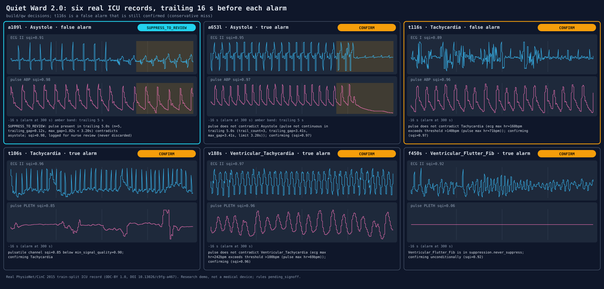

# Quiet Ward 2.0: Devpost submission draft

> Research demo, not a medical device. The alarm rules are `pending_signoff`: engineering defaults, not signed clinical rules. Nothing below is a clinical claim. Draft status: no QNX runtime result exists yet; every place where one belongs is marked `[PENDING P1: ...]`.

Category: Robotics & Medical. Bonus: Best use of QNX-specific Technologies.

## Elevator Pitch

A second opinion on bedside alarms that can never silence the first. Quiet Ward checks the signals behind an arrhythmia alarm and, when a second channel contradicts it, queues the alarm for a nurse to review instead of treating it as urgent. The bedside alarm is never removed, and every fault fails open to CONFIRM.

## Inspiration

openFDA MAUDE report 10055677 is a manufacturer malfunction report: the external alarm lamp for a NICU bed did not light and no alarm sounded on the monitor. The report says no adverse event to patient or user was reported, so we do not present it as patient harm. It still frames the first question any alarm system must answer: what happens when something goes wrong? Our answer is an invariant: an alarm is never silently dropped.

## What it does

- Reads a real ICU record (ECG plus a pulsatile channel such as ABP or PLETH) and the alarm type that fired.
- Decides **CONFIRM** or **SUPPRESS_TO_REVIEW**. A candidate suppression is not discarded: it goes to a review queue on `/dev/quietward` for a nurse ACK, with timeout escalation, and the reason is logged.
- Never suppresses on the never-suppress list (ventricular flutter/fibrillation) and does not attempt suppression when the pulse channel quality is too low.
- Fails open to CONFIRM on: detector crash, decision deadline, a 17th pending alarm, detached shared memory, backward clock step, and restart (journal replay).

On six real records (a demonstration, not an accuracy measurement) five are confirmed and one false asystole alarm (a109l) goes to review; no true alarm is queued for review. Record t116s is a false alarm that is still confirmed: the intended failure direction.

## How we built it

**Verified on the host (portable C11, macOS and Linux):**
- The detection and rule core (`qw_core`, `rules`, detector config loader), no heap allocation per decision, reentrant.
- The IPC building blocks as plain C11: the per-bed seqlock ring, the gateway state machine (pending table, review queue, deadline, nurse ACK validation, restart journal), the audit-line formatter and the JSONL log serializer.
- `make gateway-test`: `qw_gateway_test: 529 checks, 0 failed`. A 1000-mutation seeded fuzzer passes 1000/1000. One-off ASan+UBSan builds are clean.

**Written but not yet compiled or run on QNX:** the six `#ifdef __QNX__` process sources under `src/qnx/` (acquisition, detector, alarm manager, fail-open helper, supervisor, bed control) and the `make qnx` cross-build. They use QNX message passing and pulses, a resource manager at `/dev/quietward`, `slog2`, and QPLMS (with a small parent supervisor as the fallback if QPLMS is absent from the image). None of this has been built with `qcc` or booted: it waits on the SDP 8.0 licence (P1).

`[PENDING P1: replace with measured QEMU pidin/slog2info capture after SDP 8.0 boot]`

## Challenges we ran into

- **Our own Kill Rule failed on held-out data.** Asystole false negatives moved from 0 to 1 on only 37 Asystole records. We did not retune on the held-out set. We ship the honest framing (Variant B): a secondary review and escalation gateway, not a validated suppressor.
- **QNX 8.0 has no macOS or ARM host, and HAM is gone.** The SDK runs on x86_64 Linux, so the QNX build and QEMU boot need a Linux host (a free Codespace or similar) once the licence is in. High Availability Manager is deprecated in 8.0; the replacement is QPLMS, which we plan to check in the target image and fall back from honestly.
- **Clinical rules need a physician.** The thresholds stay `pending_signoff`, and clinical literature claims are held back until signed.

## Accomplishments that we're proud of

Source: real PhysioNet/CinC 2015 training records, local split, Challenge score in percent. "Base" confirms every alarm.

| Train (N=523) | Score | FN |
|---|---|---|
| Base | 39.2% | 0 |
| v0 (frozen) | 40.2% | 49 |
| fixed | 53.8% | 3 |

Fixed true-alarm recall 98.5% (202 of 205), Wilson 95% CI [95.8-99.5]. Kill Rule: PASS.

| Held-out (N=227) | Score | FN |
|---|---|---|
| Base | 39.2% | 0 |
| v0 (frozen) | 40.8% | 18 |
| fixed | 51.5% | 3 |

Fixed true-alarm recall 96.6% (86 of 89), Wilson 95% CI [90.6-98.8]. Kill Rule: **FAIL** (Asystole 0 to 1).

The PhysioNet/CinC 2015 winners scored 81.39 and 85.04 on a different 500-record hidden test set; our numbers come from a local split and are not comparable.

Also: 529 host gateway checks, 0 failed; fuzzer 1000/1000; ASan+UBSan clean; zero synthetic waveforms; zero paid APIs; everything builds offline from a fresh clone.

## What's next

1. P1: claim the myQNX SDP 8.0 licence and bring up the target on an x86_64 Linux host.
2. `make qnx`: compile the six process sources with `qcc` and fix what the compiler finds.
3. A 10-run QEMU G3 soak (kill the detector, kill acquisition, restart the alarm manager) with real `pidin` and `slog2info` captures. QEMU runs under TCG, so timings are logical time, not hardware real time.
4. A video under 3 minutes (storyboard in `video/SCRIPT_V2_DRAFT.md`).

`[PENDING P1: replace with measured QEMU pidin/slog2info capture after SDP 8.0 boot]`

## Built With

C11, POSIX, QNX Neutrino 8.0 (message passing, pulses, resource manager, slog2, QPLMS; planned, not yet built), QEMU, Python (standard library only), GNU Make, SVG, PhysioNet/CinC 2015 data (ODC-BY 1.0), openFDA.

## Data and citations

- Data: PhysioNet/Computing in Cardiology Challenge 2015, real de-identified ICU records, ODC-BY 1.0. Clifford GD, Silva I, Moody B, Li Q, Kella D, Shahin A, Kooistra T, Perry D, Mark RG (2015). Reducing False Arrhythmia Alarms in the ICU. Computing in Cardiology 42:273-276. DOI 10.13026/c9fg-a467
- openFDA MAUDE report 10055677 (manufacturer malfunction report, received 14 May 2020): re-fetch and quote exactly before submitting.
- Repo documents: README, JUDGES.md, DATA_CARD.md, `submission/g3/stress-checklist.md`.
